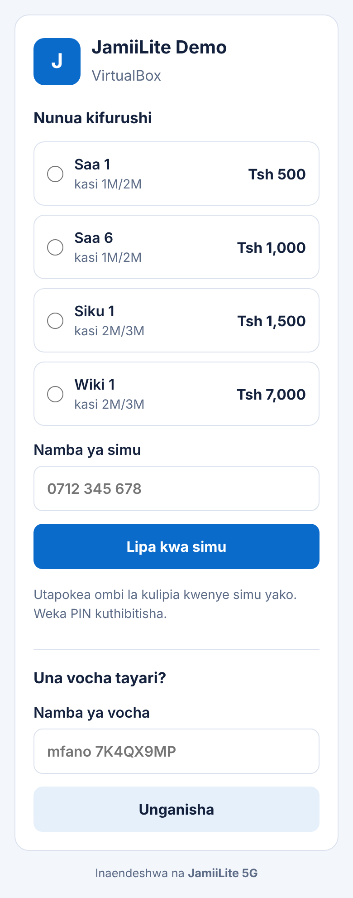
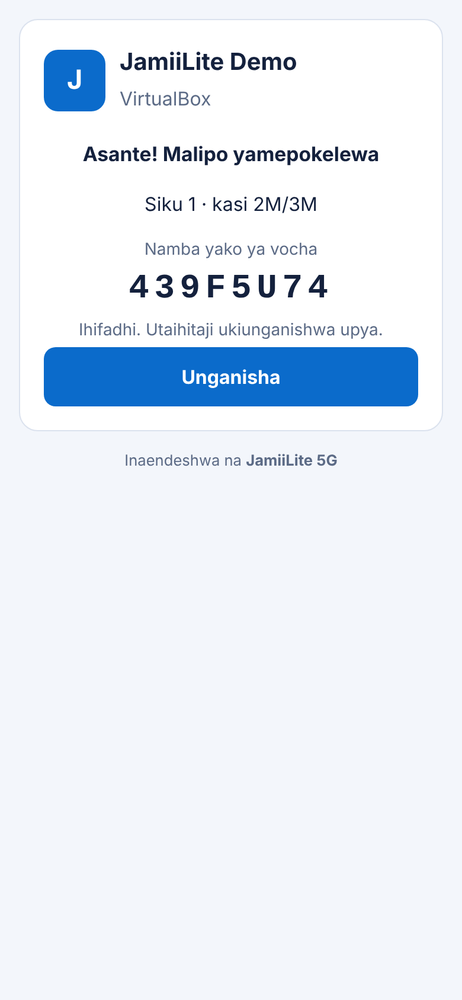

# JamiiLite 5G

Mfumo wa kusimamia biashara ya WiFi hotspot kwa wamiliki wa routers (MikroTik):
kuuza vifurushi, kupokea malipo ya simu, kutoa vocha, na kumkata mteja muda
ukiisha.

 

## Hali ya sasa (Awamu ya 1)

- **Wamiliki, routers na vifurushi** kupitia admin panel (`/admin/`)
- **Ukurasa wa kulipia** kwa Kiswahili kwa kila router: `/p/<kitambulisho>/`
- **Malipo ya majaribio (sandbox)**: kila malipo yanafanikiwa papo hapo, kisha mteja anapewa vocha
- **Vocha** zinatumwa kwa MikroTik ili mteja aunganishwe
- Database: **Supabase Postgres**. Picha (logo): **Supabase Storage**

Kinachofuata:
- **Awamu ya 2:** RADIUS, ili MikroTik iulize mfumo huu kama vocha ni halali
- **Awamu ya 3:** malipo halisi (Selcom / AzamPay / ClickPesa) na dashboard ya mmiliki

## Kuanza (local)

```bash
python3 -m venv .venv
source .venv/bin/activate
pip install -r requirements.txt
cp .env.example .env          # kisha jaza thamani zako
python manage.py migrate
python manage.py createsuperuser
python manage.py seed_demo    # data ya mfano
python manage.py runserver
```

Fungua `http://127.0.0.1:8000/p/demo/` kuona ukurasa wa kulipia, na
`http://127.0.0.1:8000/admin/` kwa usimamizi.

Bila `DATABASE_URL`, na `DEBUG=True`, mfumo unatumia SQLite. Bila keys za
Supabase Storage, picha zinahifadhiwa kwenye folda `media/`.

## Kuunganisha na Supabase

### 1. Database
Supabase Dashboard → **Connect** → nakili **Session pooler** connection string
(port 5432) na uiweke kama `DATABASE_URL` kwenye `.env`. Kisha:

```bash
python manage.py migrate
```

> **Usalama:** Supabase inaweka schema `public` wazi kupitia Data API. Baada ya
> kila `migrate`, mfumo huu unawasha **RLS** kwenye kila table ya `public` na
> kuondoa ruhusa za `anon` na `authenticated` (angalia `core/supabase.py`).
> Kwa hiyo malipo, vocha na RADIUS secrets haziwezi kusomwa kwa anon key.
> Django yenyewe inaunganishwa kama mmiliki wa tables, kwa hiyo haiathiriki.
> Ukiongeza tables kwa mkono kupitia SQL Editor, endesha `migrate` tena au
> washa RLS mwenyewe.

### 2. Storage (picha)
1. **Storage → New bucket** → jina `jamiilite-media` → weka **Public bucket** ✅
2. **Storage → Settings → S3 Connection**: nakili **Region**, kisha
   **New access key** ili upate *Access key ID* na *Secret access key*
3. Jaza kwenye `.env`:
   ```
   SUPABASE_PROJECT_REF=abcdefghijklmnop     # kutoka kwenye URL ya project
   SUPABASE_STORAGE_BUCKET=jamiilite-media
   SUPABASE_S3_REGION=...
   SUPABASE_S3_ACCESS_KEY_ID=...
   SUPABASE_S3_SECRET_ACCESS_KEY=...
   ```

S3 keys zina ruhusa kamili juu ya Storage. Ziweke kwenye server tu, kamwe
zisiwe kwenye browser au git.

## Kuunganisha na MikroTik (kwa ukurasa wa kulipia)

MikroTik inampeleka mteja kwenye ukurasa wetu, kisha ukurasa unatuma vocha
kurudi kwa MikroTik ili aunganishwe:

1. **Walled garden**: ruhusu domain ya mfumo huu kabla mteja hajaingia:
   ```
   /ip hotspot walled-garden add dst-host=jamiilite.example.com
   ```
2. **Login kwa PAP**: vocha inatumwa kama username na password:
   ```
   /ip hotspot profile set [find] login-by=http-pap
   ```
3. **Peleka mteja kwenye ukurasa wetu**: badilisha `hotspot/login.html` ya
   MikroTik iwe na redirect hii (badilisha `demo` kuwa kitambulisho cha router):
   ```html
   <meta http-equiv="refresh" content="0; url=https://jamiilite.example.com/p/demo/?link-login-only=$(link-login-only-esc)&link-orig=$(link-orig-esc)&mac=$(mac-esc)&ip=$(ip)&error=$(error-esc)">
   ```

Hadi Awamu ya 2 (RADIUS) ikamilike, MikroTik haijui vocha zinazotolewa na
mfumo huu, kwa hiyo bado haitamkubali mteja. Ukurasa wa kulipia unaweza
kujaribiwa wenyewe hadi hapo.

Ukiweka **login URL ya hotspot** kwenye router (admin), vocha zinatumwa hapo
tu, na `link-login-only` inayokuja kwenye link inapuuzwa. Hii inazuia mtu
kutengeneza link inayotuma vocha kwa server nyingine.

## Majaribio

```bash
DEBUG=True python manage.py test
```

## Muundo

| Folda | Kazi |
|---|---|
| `config/` | Settings (Supabase Postgres + Storage), URLs |
| `core/` | Wamiliki, routers, vifurushi, ulinzi wa RLS |
| `billing/` | Malipo, vocha, watoa huduma wa malipo (`providers/`) |
| `portal/` | Ukurasa wa kulipia anaouona mteja |
